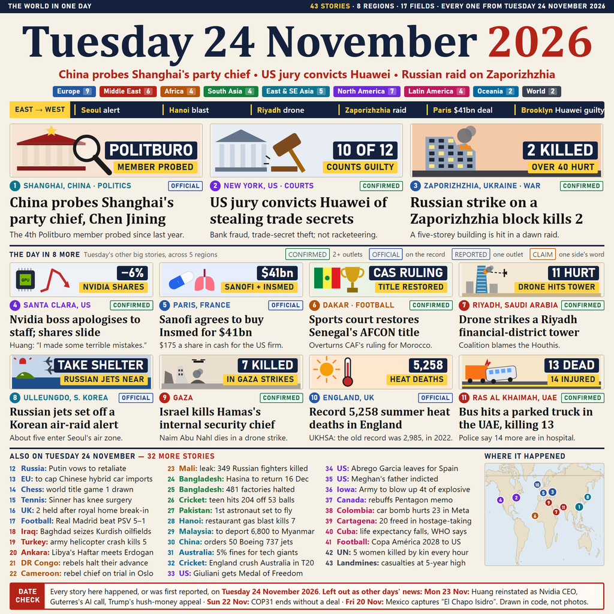

# world-front-1124

[](https://make.fun/bounty/news-image-20261124?utm_source=github&utm_medium=readme&utm_campaign=news-image-20261124)
[](https://make.fun/bounty/news-image-20261124/leaderboard?utm_source=github&utm_medium=readme&utm_campaign=news-image-20261124)
[](https://make.fun/bounty/news-image-20261124?utm_source=github&utm_medium=readme&utm_campaign=news-image-20261124)

Tuesday 24 November 2026 on one page, made for the [make.fun](https://make.fun/?utm_source=github&utm_medium=readme&utm_campaign=news-image-20261124)
bounty "Sum up 24 November's world news in one image".



Three drawn leads: China puts Shanghai's party chief Chen Jining under investigation; a US jury convicts Huawei of
stealing trade secrets; and a Russian strike on a Zaporizhzhia apartment block kills two. Eight drawn cards follow,
each with its key number in large type (Nvidia, Sanofi's $41bn deal, Senegal's AFCON title, Riyadh, a Korean
air-raid alert, Gaza, England's record heat deaths, a UAE bus crash), then 32 more stories in a short list, a map,
region counts and a date check that names what was left out because it happened on another day.

Each story carries a tag: CONFIRMED (two or more outlets), OFFICIAL (on the record), REPORTED (one outlet) or
CLAIM (one side's word). [docs/sources.md](docs/sources.md) lists the outlets behind every line.

## Build and run

- `tools/stories.py` holds every story; `tools/pictures.py` draws each picture as SVG; `tools/build.py` writes
  the page as HTML (set `NE_DIR` to a folder holding Natural Earth's public-domain `ne_110m_land.geojson`, not
  committed, for the map).
- `tools/render.ps1` screenshots the page with headless Chrome at 2x and `tools/shrink.py` scales it to the
  1024 x 1024 `entry.png` (under 1 MiB).
- `main.ts` (Node 22, no dependencies, no network) checks `entry.png` and copies it to `/output/entry.png`:

```sh
mkdir -p out && MAKEFUN_OUTPUT_DIR=out node main.ts
```

No photos and no image-generation model: every picture and the map are drawn from plain shapes in code.

MIT licence, see [LICENSE](LICENSE).
